# Poly Haven: Wood textures

**47 assets from [Poly Haven](https://polyhaven.com), dedicated to the public domain under [CC0](https://polyhaven.com/license).** Use them in any game, free or paid, and change them however you like; no credit is needed.

PBR textures as 1K and 2K JPG maps (colour, normal (GL and DX), roughness, AO, displacement and more). 892.7 MB in all.

This is a copy kept by [zuujis-cc0](https://github.com/zuujis-cc0) so game makers can take single files from GitHub. It is not made by or affiliated with Poly Haven: the originals, often in more formats and higher resolutions, are on [polyhaven.com](https://polyhaven.com). If they help you, consider [supporting Poly Haven](https://www.patreon.com/polyhaven/overview).

Every file is listed in [MANIFEST.tsv](MANIFEST.tsv) with its size and SHA-256. More free assets: [the Zuujis collection](https://github.com/zuujis-cc0/free-game-assets#readme).

| | | | |
| :-: | :-: | :-: | :-: |
| <a href="palm_tree_bark">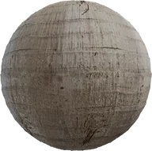</a> <b><a href="palm_tree_bark">Palm Tree Bark</a></b> by Dimitrios Savva, Rico Cilliers · <a href="https://polyhaven.com/a/palm_tree_bark">source</a> |  <b><a href="pine_bark">Pine Bark</a></b> by Dimitrios Savva · <a href="https://polyhaven.com/a/pine_bark">source</a> | <a href="plank_flooring">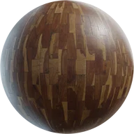</a> <b><a href="plank_flooring">Plank Flooring</a></b> by Dario Barresi, Dimitrios Savva, Rico Cilliers · <a href="https://polyhaven.com/a/plank_flooring">source</a> | <a href="plank_flooring_02">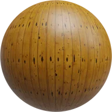</a> <b><a href="plank_flooring_02">Plank Flooring 02</a></b> by Dario Barresi, Dimitrios Savva · <a href="https://polyhaven.com/a/plank_flooring_02">source</a> |
| <a href="plank_flooring_03">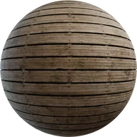</a> <b><a href="plank_flooring_03">Plank Flooring 03</a></b> by Jenelle van Heerden, Matterfield · <a href="https://polyhaven.com/a/plank_flooring_03">source</a> |  <b><a href="plank_flooring_04">Plank Flooring 04</a></b> by Dimitrios Savva · <a href="https://polyhaven.com/a/plank_flooring_04">source</a> | <a href="planks_brown_10">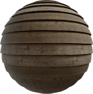</a> <b><a href="planks_brown_10">Planks Brown 10</a></b> by Rob Tuytel · <a href="https://polyhaven.com/a/planks_brown_10">source</a> |  <b><a href="plywood">Plywood</a></b> by Rob Tuytel · <a href="https://polyhaven.com/a/plywood">source</a> |
| <a href="raw_plank_wall">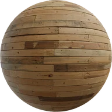</a> <b><a href="raw_plank_wall">Raw Plank Wall</a></b> by Dimitrios Savva · <a href="https://polyhaven.com/a/raw_plank_wall">source</a> |  <b><a href="raw_wooden_floor_01">Raw Wooden Floor 01</a></b> by Charlotte Baglioni · <a href="https://polyhaven.com/a/raw_wooden_floor_01">source</a> |  <b><a href="rectangular_parquet">Rectangular Parquet</a></b> by Jenelle van Heerden, Sergej Majboroda · <a href="https://polyhaven.com/a/rectangular_parquet">source</a> | <a href="red_oak_veneer">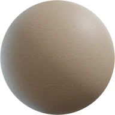</a> <b><a href="red_oak_veneer">Red Oak Veneer</a></b> by Jenelle van Heerden · <a href="https://polyhaven.com/a/red_oak_veneer">source</a> |
| <a href="romantic_veneer">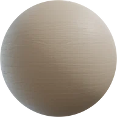</a> <b><a href="romantic_veneer">Romantic Veneer</a></b> by Jenelle van Heerden · <a href="https://polyhaven.com/a/romantic_veneer">source</a> | <a href="roof_planks">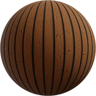</a> <b><a href="roof_planks">Roof Planks</a></b> by Rob Tuytel · <a href="https://polyhaven.com/a/roof_planks">source</a> |  <b><a href="rosewood_veneer1">Rosewood Veneer1</a></b> by Jenelle van Heerden · <a href="https://polyhaven.com/a/rosewood_veneer1">source</a> |  <b><a href="rosewood_veneer_02">Rosewood Veneer 02</a></b> by Jenelle van Heerden · <a href="https://polyhaven.com/a/rosewood_veneer_02">source</a> |
|  <b><a href="rough_pine_door">Rough Pine Door</a></b> by Dimitrios Savva · <a href="https://polyhaven.com/a/rough_pine_door">source</a> |  <b><a href="rough_wood">Rough Wood</a></b> by Rob Tuytel · <a href="https://polyhaven.com/a/rough_wood">source</a> |  <b><a href="sakura_bark">Sakura Bark</a></b> by Charlotte Baglioni · <a href="https://polyhaven.com/a/sakura_bark">source</a> |  <b><a href="sapele_veneer">Sapele Veneer</a></b> by Jenelle van Heerden · <a href="https://polyhaven.com/a/sapele_veneer">source</a> |
| <a href="sapele_veneer_02">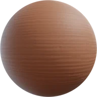</a> <b><a href="sapele_veneer_02">Sapele Veneer 02</a></b> by Jenelle van Heerden · <a href="https://polyhaven.com/a/sapele_veneer_02">source</a> | <a href="silver_oak_veneer_01">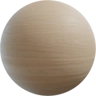</a> <b><a href="silver_oak_veneer_01">Silver Oak Veneer 01</a></b> by Jenelle van Heerden · <a href="https://polyhaven.com/a/silver_oak_veneer_01">source</a> |  <b><a href="silver_oak_veneer_02">Silver Oak Veneer 02</a></b> by Jenelle van Heerden · <a href="https://polyhaven.com/a/silver_oak_veneer_02">source</a> | <a href="smoke_speckled_veneer">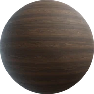</a> <b><a href="smoke_speckled_veneer">Smoke Speckled Veneer</a></b> by Jenelle van Heerden · <a href="https://polyhaven.com/a/smoke_speckled_veneer">source</a> |
| <a href="smoked_walnut_veneer">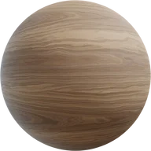</a> <b><a href="smoked_walnut_veneer">Smoked Walnut Veneer</a></b> by Jenelle van Heerden · <a href="https://polyhaven.com/a/smoked_walnut_veneer">source</a> |  <b><a href="stained_pine">Stained Pine</a></b> by Dario Barresi, Jenelle van Heerden · <a href="https://polyhaven.com/a/stained_pine">source</a> |  <b><a href="stair_planks">Stair Planks</a></b> by Rob Tuytel · <a href="https://polyhaven.com/a/stair_planks">source</a> |  <b><a href="synthetic_wood">Synthetic Wood</a></b> by Charlotte Baglioni, Dario Barresi · <a href="https://polyhaven.com/a/synthetic_wood">source</a> |
|  <b><a href="teak_veneer">Teak Veneer</a></b> by Jenelle van Heerden · <a href="https://polyhaven.com/a/teak_veneer">source</a> |  <b><a href="tree_bark_03">Tree Bark 03</a></b> by Rob Tuytel · <a href="https://polyhaven.com/a/tree_bark_03">source</a> |  <b><a href="trident_maple_bark">Trident Maple Bark</a></b> by Charlotte Baglioni · <a href="https://polyhaven.com/a/trident_maple_bark">source</a> |  <b><a href="walnut_veneer">Walnut Veneer</a></b> by Jenelle van Heerden · <a href="https://polyhaven.com/a/walnut_veneer">source</a> |
|  <b><a href="walnut_veneer_02">Walnut Veneer 02</a></b> by Jenelle van Heerden · <a href="https://polyhaven.com/a/walnut_veneer_02">source</a> | <a href="washed_grey_oak_veneer">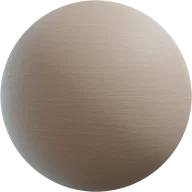</a> <b><a href="washed_grey_oak_veneer">Washed Grey Oak Veneer</a></b> by Jenelle van Heerden · <a href="https://polyhaven.com/a/washed_grey_oak_veneer">source</a> | <a href="weathered_brown_planks">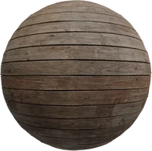</a> <b><a href="weathered_brown_planks">Weathered Brown Planks</a></b> by Dimitrios Savva, Rico Cilliers · <a href="https://polyhaven.com/a/weathered_brown_planks">source</a> | <a href="weathered_peeling_timber">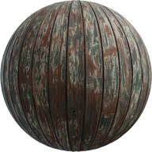</a> <b><a href="weathered_peeling_timber">Weathered Peeling Timber</a></b> by Dimitrios Savva · <a href="https://polyhaven.com/a/weathered_peeling_timber">source</a> |
| <a href="weathered_plank_siding">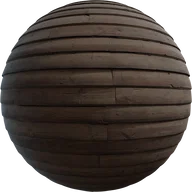</a> <b><a href="weathered_plank_siding">Weathered Plank Siding</a></b> by Dimitrios Savva · <a href="https://polyhaven.com/a/weathered_plank_siding">source</a> |  <b><a href="weathered_planks">Weathered Planks</a></b> by Dario Barresi, Dimitrios Savva · <a href="https://polyhaven.com/a/weathered_planks">source</a> | <a href="white_maple_veneer">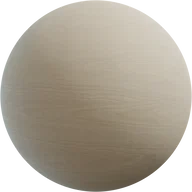</a> <b><a href="white_maple_veneer">White Maple Veneer</a></b> by Jenelle van Heerden · <a href="https://polyhaven.com/a/white_maple_veneer">source</a> |  <b><a href="white_oak_veneer">White Oak Veneer</a></b> by Jenelle van Heerden · <a href="https://polyhaven.com/a/white_oak_veneer">source</a> |
| <a href="white_planks_clean">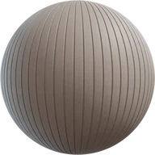</a> <b><a href="white_planks_clean">White Planks Clean</a></b> by Rob Tuytel · <a href="https://polyhaven.com/a/white_planks_clean">source</a> |  <b><a href="wood_cabinet_worn_long">Wood Cabinet Worn Long</a></b> by Dimitrios Savva, Rico Cilliers · <a href="https://polyhaven.com/a/wood_cabinet_worn_long">source</a> | <a href="wood_floor">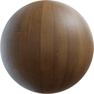</a> <b><a href="wood_floor">Wood Floor</a></b> by Dimitrios Savva · <a href="https://polyhaven.com/a/wood_floor">source</a> | <a href="wood_floor_deck">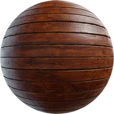</a> <b><a href="wood_floor_deck">Wood Floor Deck</a></b> by Dimitrios Savva · <a href="https://polyhaven.com/a/wood_floor_deck">source</a> |
| <a href="wood_floor_worn">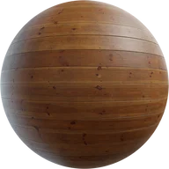</a> <b><a href="wood_floor_worn">Wood Floor Worn</a></b> by Dimitrios Savva · <a href="https://polyhaven.com/a/wood_floor_worn">source</a> |  <b><a href="wood_peeling_paint_weathered">Wood Peeling Paint Weathered</a></b> by Dimitrios Savva, Rob Tuytel · <a href="https://polyhaven.com/a/wood_peeling_paint_weathered">source</a> |  <b><a href="wood_plank_wall">Wood Plank Wall</a></b> by Dimitrios Savva · <a href="https://polyhaven.com/a/wood_plank_wall">source</a> |  |

---

Kept up to date by this repository's own [update workflow](.github/workflows/update.yml), with code and plan from [cc0-mirror](https://github.com/zuujis-cc0/cc0-mirror). Something wrong? [Open an issue there](https://github.com/zuujis-cc0/cc0-mirror/issues/new) or use the [private report form](https://games.zuujis.com/report).
